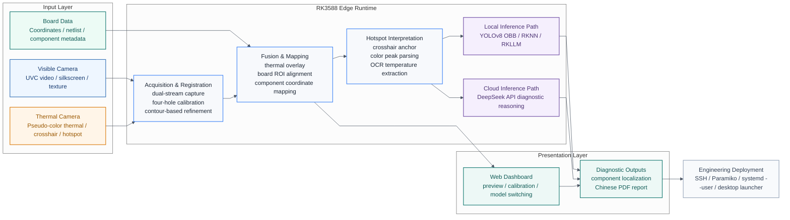

# 基于RK3588的多模态电路故障诊断与云端大模型协同推理系统

**RK3588-Based Multimodal PCB Fault Diagnosis with Collaborative Cloud / Edge LLM Inference**

[](./LICENSE)


本项目面向 **PCB 电路板故障诊断与嵌入式边缘智能分析** 场景，基于 RK3588 开发板构建一套融合 **可见光 + 热成像 + 坐标文件 / 网表 + 大模型推理** 的多模态诊断系统。  
It targets **PCB fault diagnosis and edge AI inspection**, combining **visible imaging, thermal imaging, board coordinate data, and LLM reasoning** on an RK3588 platform.

项目支持在板端完成视频采集、手动标定、热像融合、器件定位、温度 OCR、诊断报告生成，并支持 **DeepSeek API** 与 **本地 RKLLM** 两条诊断路径切换。  
The system runs acquisition, calibration, thermal fusion, component localization, OCR-based temperature extraction, and PDF report generation on-device, while supporting both **cloud DeepSeek API** and **local RKLLM inference**.

> 适用于全国大学生嵌入式芯片与系统设计竞赛应用赛道展示，也适合作为 PCB 热异常分析、教学实验和边缘智能部署样例工程。  
> Suitable for embedded AI competitions, PCB thermal inspection demos, teaching labs, and edge deployment showcases.

## 项目亮点 | Highlights

- **多模态融合**：同步接入 UVC 可见光相机与海康热成像相机，实现热像与器件级可见光坐标对齐  
  **Multimodal fusion**: aligns thermal imagery with visible-light PCB component coordinates

- **板级定位到器件级归因**：基于四孔标定、透视变换、网表/坐标映射，将热区归属到具体器件  
  **Board-to-component reasoning**: maps hotspots from board coordinates to actual components

- **边缘部署**：主流程运行于 RK3588，支持本地 RKLLM 推理与网页端操作  
  **Edge deployment**: core pipeline runs on RK3588 with local RKLLM support

- **中文诊断报告**：自动生成带热点截图、器件信息和诊断结论的 PDF 报告  
  **Chinese PDF reports**: generates visual diagnostic reports with hotspot evidence

- **竞赛友好交互**：提供 Web Dashboard、桌面启动脚本、远程控制与可视化状态反馈  
  **Competition-friendly UX**: includes a dashboard, launcher scripts, and remote control tools

## 系统架构 | System Architecture

GitHub 原生渲染的 Mermaid 架构图在首页缩放时更清晰，也更适合持续维护。  
This Mermaid diagram renders natively on GitHub and stays sharper than a bitmap image.



如需论文/答辩版高分辨率矢量图，建议下一步把同一份结构转成 `Graphviz` 或 `D2` 导出 SVG / PDF。  
For a paper-ready vector figure, the next step is exporting the same structure through Graphviz or D2 as SVG/PDF.

## 典型工作流 | Demo Workflow

1. 接入可见光相机与热成像相机  
   Connect visible and thermal cameras
2. 上传板卡坐标文件 / 网表  
   Load PCB coordinate file / netlist-derived board model
3. 手动标定可见光四孔与热像四孔  
   Calibrate visible and thermal views using mounting holes
4. 执行热像融合与器件定位  
   Run fusion and component localization
5. 根据热点、温度 OCR 与器件信息生成诊断结论  
   Produce diagnosis from hotspot location, OCR temperature, and component metadata
6. 导出中文 PDF 诊断报告  
   Export a Chinese PDF report

## 核心能力 | Core Capabilities

| 模块 | 说明 |
| --- | --- |
| 视频采集 | 可见光、热成像、融合画面三路实时预览 |
| 标定与融合 | 四孔手动标定 + OpenCV 透视映射与二次微调 |
| 器件映射 | 基于 `board_model.json` / 坐标文件进行位号与器件属性映射 |
| 热点分析 | 热区定位、热点归属、热异常辅助判断 |
| OCR | 读取热成像画面温度文本 |
| 目标检测 | 支持 YOLOv8 OBB 结果在可见光图像上叠加 |
| 报告生成 | 生成中文 PDF 诊断报告 |
| 推理方式 | DeepSeek API / 本地 RKLLM 双路径切换 |

## 关键技术 | Technical Stack

- **OpenCV**：视频采集、轮廓提取、透视变换、几何对齐
- **RapidOCR**：热像温度文字识别
- **YOLOv8 OBB**：器件检测与辅助定位
- **ReportLab**：中文 PDF 报告生成
- **RK3588 / RKNN / RKLLM**：边缘侧模型推理部署
- **Web Dashboard**：前端交互、标定、状态展示、报告触发

## 仓库结构 | Repository Layout

```text
.
|- board_stream_server.py             # 主服务：采集、融合、OCR、定位、报告、LLM
|- index.html                         # Web 页面
|- app.js                             # 前端交互逻辑
|- styles.css                         # 页面样式
|- board_model.json                   # 示例板卡模型 / 器件坐标
|- sample-coordinates.csv             # 示例坐标文件
|- deploy_to_board.py                 # 部署到 RK3588 开发板
|- remote_control.py                  # 远程启停 / 状态控制
|- start_fusion_dashboard_remote.sh   # 板端启动脚本
|- fusion-dashboard.service           # systemd 用户服务配置
|- llm_config.example.json            # 大模型配置示例
`- vendor/xlsx.full.min.js            # 第三方前端依赖
```

## 快速开始 | Quick Start

### 1. 安装依赖 | Install dependencies

```bash
pip install -r requirements.txt
```

### 2. 配置大模型 | Configure LLM

仓库不包含任何真实密钥。复制示例配置：

```bash
cp llm_config.example.json llm_config.json
```

也可以改用环境变量：

- `DEEPSEEK_API_KEY`
- `DEEPSEEK_MODEL`
- `DEEPSEEK_BASE_URL`
- `RKLLM_ROOT`
- `RKLLM_SERVER_URL`
- `RKLLM_SERVER_MODEL`
- `RKLLM_MAX_NEW_TOKENS`
- `RKLLM_MAX_CONTEXT_LEN`

### 3. 部署到 RK3588 | Deploy to RK3588

```bash
export BOARD_HOST=your-board-ip
export BOARD_USER=elf
export BOARD_PASSWORD=your-password
python deploy_to_board.py
```

Windows 下可以直接用：

```bat
start_dashboard.cmd your-board-ip
restart_dashboard.cmd your-board-ip
status_dashboard.cmd your-board-ip
stop_dashboard.cmd your-board-ip
```

## 开源说明 | Open-Source Notes

- 本仓库已移除真实 API Key、板端运行缓存、临时抓帧、历史诊断报告和本地虚拟环境
- 本仓库不附带专有中文字体文件，请根据自身授权情况本地配置
- `vendor/xlsx.full.min.js` 为第三方依赖，详见 [NOTICE](./NOTICE)

## 已知事项 | Notes

- PDF 中文字体会根据运行环境回退到可用系统字体
- 本地 RKLLM 路径需要按开发板实际部署位置调整
- 部分检测与 OCR 相关能力依赖目标环境中的模型文件或额外运行时

## License

本项目采用 [Apache-2.0](./LICENSE) 许可证。  
This project is released under the [Apache-2.0 License](./LICENSE).
