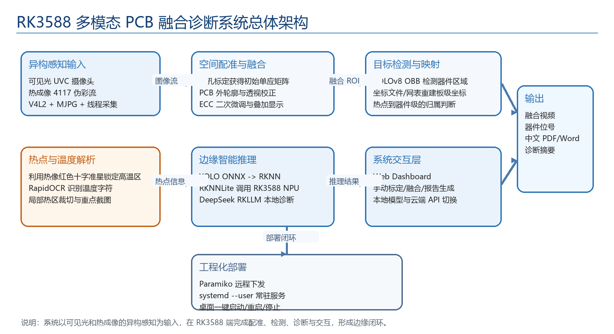

# 基于RK3588的多模态电路故障诊断与云端大模型协同推理系统

这是一个面向 RK3588 开发板的多模态 PCB 故障诊断项目。系统接入 UVC 可见光相机和海康热成像相机，在板端完成视频采集、手动标定、热像融合、器件定位、温度 OCR、诊断报告生成，以及 DeepSeek API / 本地 RKLLM 推理切换。



## 功能概览

- 可见光、热成像、融合画面三路 Web 预览
- 四孔手动标定 + 轮廓二次微调
- 基于坐标文件/网表的器件位号映射
- YOLOv8 OBB 可见光检测结果叠加
- 热像高温点定位与器件归属分析
- 热像温度 OCR 识别
- 中文 PDF 诊断报告生成
- DeepSeek API 与 RK3588 本地 RKLLM 双路径推理
- 开发板桌面一键启动、重启、停止

## 仓库结构

- `board_stream_server.py`: 主服务，包含视频采集、融合、坐标映射、OCR、报告生成、LLM 调用
- `index.html` / `app.js` / `styles.css`: Web Dashboard 前端
- `board_model.json`: 示例板卡坐标与器件模型
- `sample-coordinates.csv`: 示例坐标文件
- `deploy_to_board.py`: 从 PC 向开发板部署代码
- `remote_control.py`: 远程启动/停止/重启/查看状态
- `start_fusion_dashboard_remote.sh`: 板端启动脚本
- `fusion-dashboard.service`: systemd 用户服务配置

## 运行环境

### 开发板

- RK3588
- Ubuntu / Debian 类 Linux
- Python 3.10+
- OpenCV 可访问 `/dev/video*`
- 可选：本地 RKLLM 运行环境

### Python 依赖

```bash
pip install -r requirements.txt
```

如果需要使用 YOLO OBB、RapidOCR、PDF 报告，请确保对应依赖安装完整。

## 配置说明

仓库不包含任何真实密钥。请复制示例配置：

```bash
cp llm_config.example.json llm_config.json
```

或者直接使用环境变量：

- `DEEPSEEK_API_KEY`
- `DEEPSEEK_MODEL`
- `DEEPSEEK_BASE_URL`
- `RKLLM_ROOT`
- `RKLLM_SERVER_URL`
- `RKLLM_SERVER_MODEL`
- `RKLLM_MAX_NEW_TOKENS`
- `RKLLM_MAX_CONTEXT_LEN`

## 部署到开发板

设置环境变量后执行：

```bash
export BOARD_HOST=your-board-ip
export BOARD_USER=elf
export BOARD_PASSWORD=your-password
python deploy_to_board.py
```

Windows 下也可以使用：

```bat
start_dashboard.cmd your-board-ip
restart_dashboard.cmd your-board-ip
status_dashboard.cmd your-board-ip
stop_dashboard.cmd your-board-ip
```

## 开源发布说明

- 本仓库已移除真实 API Key、板端运行缓存、临时抓帧、诊断报告和本地虚拟环境
- 本仓库不附带专有中文字体文件
- 示例 `board_model.json` 用于展示坐标重建、器件映射与融合流程

## 已知事项

- `vendor/xlsx.full.min.js` 为第三方前端依赖，详细信息见 `NOTICE`
- PDF 中文字体在不同设备上可能回退到系统字体
- 本地 RKLLM 路径需要根据开发板实际部署位置调整

## License

本项目代码使用 Apache-2.0 许可证，详见 [LICENSE](./LICENSE)。
